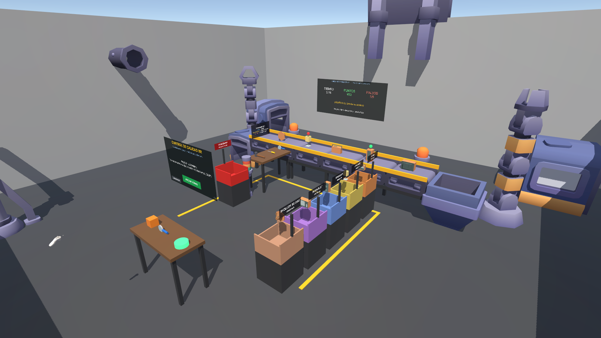

# Control de Calidad XR

Proyecto Final de **Fundamentos de Realidad Virtual 2026**. Experiencia inmersiva para **Meta Quest 2 / 3**
hecha con **Unity 6 (6000.0.58f2) + XR Interaction Toolkit 3.0 + OpenXR**, para la empresa ficticia
*UAO Immersive Solutions*.

El operario trabaja frente a una banda transportadora que entrega 5 tipos de producto (radio, lámpara,
parlante, televisor y oso de peluche). Con **lupa, destornillador y martillo** debe descubrir defectos
(grietas, tornillos flojos, piezas huecas). Los defectuosos se desechan y se reportan; los perfectos se
almacenan en su contenedor.



## Requerimientos del enunciado

- [x] **Onboarding VR**: moverse, agarrar, inspeccionar y colocar en un socket, validado con eventos XR
- [x] **Interacciones principales**: Grab Interactable, Socket, botones UI XR, háptica, audio espacial
- [x] **Eventos dinámicos**: temporizador de 3:00, fallo con 5 errores, aceleración o avería inesperada de la banda, alerta a 30 s
- [x] **Puntuación verificable**: +100 por acierto, −50 por error o producto perdido, récord histórico
- [x] **Cierre**: panel final con resultado, retroalimentación, reportes de daño y opción de reiniciar o salir

## Cómo abrirlo y probarlo

1. Abrir la carpeta con **Unity 6000.0.58f2** (incluye el módulo Android).
2. Abrir `Assets/Scenes/QualityControl.unity` y darle Play. Sin visor se activa el **XR Device Simulator**.
3. Con visor: conectar el Quest por Link (PC) o compilar el APK.

### Menú `Tools › Quality Control XR`

| Opción | Qué hace |
|---|---|
| Configure for Meta Quest | Android, IL2CPP ARM64, Vulkan, OpenXR con Meta Quest y controles Touch |
| Build Scene | Regenera toda la escena, los prefabs y los materiales desde código |
| Capture Screenshots | Renderiza vistas a `docs/screenshots` |
| Build Quest APK | Compila `Builds/ControlCalidadXR.apk` |
| Import XRI Samples / Fix Sample Materials | Importa los Starter Assets y adapta sus materiales al pipeline integrado |

Instalar el APK en el visor (modo desarrollador activado):

```bash
adb install -r Builds/ControlCalidadXR.apk
```

### Pruebas automáticas

7 pruebas PlayMode en `Assets/Tests/PlayMode` (Window › General › Test Runner). Cubren la banda física,
la clasificación en contenedores, la zona de pérdida, el onboarding, el cierre con guardado en JSON y el
fin del turno por fallos.

## Estructura

```
Assets/
  Scripts/      Core · Conveyor · Products · Tools · UI   (namespace QualityControlXR)
  Editor/       SceneBuilder · ProjectSetup · SceneSnapshot · BuildQuest
  Prefabs/      Products/ (5 productos)
  Scenes/       QualityControl.unity
  Tests/        PlayMode/
  ThirdParty/   Kenney (CC0): Factory Kit, Furniture Kit, Interface e Impact Sounds
  Samples/      XRI Starter Assets y XR Device Simulator
docs/           Enunciado, opciones de proyecto y capturas
presentation/   Presentación de sustentación (.pptx) y su generador (node build_deck.js)
```

## Manejo de datos

Cada turno se guarda en `Application.persistentDataPath/qc_history.json` (`ScoreRepository`). Se guardan
la fecha, el puntaje, los aciertos, los fallos, el tiempo jugado y los reportes de daño. Se conservan las
últimas 50 sesiones y de ahí sale el récord.

## Rúbrica

| Bloque | Peso | Criterios |
|---|---|---|
| Prueba ejecutable | 40% | UI 15% · Implementación 3D 15% · Interacciones 25% · Inmersión 25% · Montaje general 20% |
| Sustentación del proyecto | 60% | Organización Unity 15% · Scripts 15% · Manejo de datos 20% · Sustentación personal 40% · Presentación personal 10% |

## Créditos

Modelos y sonidos de [Kenney](https://kenney.nl) (CC0). Rig XR y simulador de los samples del XR Interaction Toolkit de Unity.
