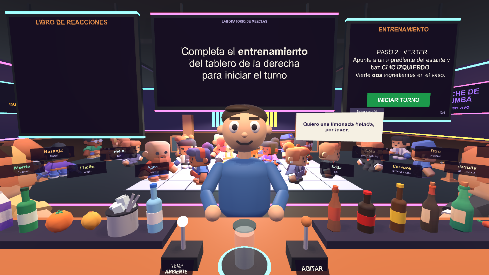

# Laboratorio de Mezclas

Proyecto Final de **Fundamentos de Realidad Virtual 2026** (opción 3 del enunciado: *Laboratorio Científico XR*),
hecho con **Unity 6 (6000.0.58f2)** y **XR Interaction Toolkit 3** para Meta Quest 3, por la empresa ficticia
*UAO Immersive Solutions*.

Eres el encargado de un laboratorio-bar. Ramiro, el cliente, pide bebidas; tú combinas ingredientes con
propiedades químicas (ácido, gas, alcohol, picante, lácteo, cafeína, frío…), ajustas la temperatura, agitas y
sirves. Si aciertas, suma puntos. Si te equivocas, **su cuerpo reacciona**: se pone rojo y suda, vomita verde,
le explota la mezcla en la cara, se le prende el pelo o cae desmayado. El **analizador** de la estación
clasifica cada mezcla (estable, inestable o tóxica); las inestables se **estabilizan** con frío o el vaso estalla.
Hay **17 reacciones por descubrir** en el libro y **38 bebidas** en la carta.

El bar es una discoteca viva: pista de baile con baldosas luminosas, DJ, bola de espejos, focos y ecualizador
sincronizados con la música, y una **rockola** con géneros (house, electrónica, guaracha, rock) que también
reproduce tus propias canciones.



## Cómo encaja en la opción 3

| El enunciado pide | En el juego |
|---|---|
| Combinar elementos | 19 ingredientes con propiedades; hasta 4 por mezcla, con temperatura y agitado |
| Activar reacciones | 17 reacciones del cliente según las propiedades sumadas de la mezcla |
| Clasificar compuestos | Analizador: estable, inestable o tóxica, antes de servir |
| Estabilizar mezclas | El frío (hielo o palanca en FRÍO) neutraliza lo inestable; si no, el vaso estalla |
| Descubrir fórmulas | 38 recetas y un libro de reacciones que se guarda entre partidas |
| Grab interactivos | Botellas, recipientes y vaso con `XRGrabInteractable` |
| Sockets químicos | Posavasos del cliente con `XRSocketInteractor` (solo acepta el vaso con mezcla) |
| Botones de laboratorio | Tableros con botones por rayo (`TrackedDeviceGraphicRaycaster` + `XRUIInputModule`) |
| Palancas de temperatura | Palanca de 3 posiciones que se arrastra con la mano (`XRSimpleInteractable`) |
| Validación química | `ReactionRules` evalúa la mezcla; el analizador avisa y el cliente reacciona |

## Requerimientos obligatorios

- [x] **Onboarding**: entrenamiento guiado (moverse, agarrar y verter, agitar, servir) validado con acciones reales; textos para PC y para VR
- [x] **Interacciones principales**: manipulación física de botellas y vaso, palancas, socket, botones; objetivo claro (el pedido) y progresión (libro, récord)
- [x] **Eventos dinámicos**: tiempo del turno, paciencia del cliente, *hora pico*, *apagón* (sin etiquetas), mezcla que estalla, 3 desmayos suspenden el turno
- [x] **Puntuación verificable**: +100 y bono por rapidez, +20 por estabilizar, −30 si estalla, cada reacción suma o resta
- [x] **Cierre**: panel final con puntaje, récord, perfectos, reacciones descubiertas y retroalimentación; tablero de historial

## Cómo jugarlo

### Meta Quest 3
1. Instalar `Builds/LaboratorioMezclas.apk` con el visor en modo desarrollador: `adb install -r Builds/LaboratorioMezclas.apk`
2. Abrirlo desde *Biblioteca › Fuentes desconocidas*.

O desde el PC con **Quest Link**: `Builds/Windows/LaboratorioMezclas.exe -vr`

| Control (VR) | Acción |
|---|---|
| Joystick izquierdo · derecho | Caminar · girar (también hay teletransporte) |
| Botón lateral (grip) | Agarrar botellas, vaso y palancas |
| Inclinar la botella sobre el vaso | Verter una dosis (para otra, enderézala y vuelve a inclinar) |
| Sacudir el vaso | Agitar (o tirar de la palanca AGITAR) |
| Voltear el vaso | Vaciarlo |
| Soltar el vaso sobre el posavasos | Servir al cliente |
| Rayo + gatillo | Botones de los tableros y la rockola |

Guía de prueba con el visor: [docs/PRUEBA_EN_QUEST.md](docs/PRUEBA_EN_QUEST.md)

### PC (mouse y teclado)
Ejecutar `Builds/Windows/LaboratorioMezclas.exe`, o abrir `Assets/Scenes/MixLab.unity` en Unity y darle **Play**.

| Control (PC) | Acción |
|---|---|
| WASD · Mouse | Caminar · mirar |
| Clic izquierdo sobre un ingrediente | Verter una dosis en el vaso (máximo 4) |
| Clic izquierdo sobre una palanca | Cambiar temperatura / agitar |
| Clic izquierdo sobre el vaso | Agarrarlo; luego apunta al cliente y haz clic para servir |
| Clic izquierdo sobre el lavaplatos | Vaciar el vaso |
| R · Esc · H | Dejar el vaso · pausa · ayuda |
| G · N · M | Género · canción · silencio |

**Modo demostración**: `LaboratorioMezclas.exe -autodemo -roundSeconds 70` juega un turno solo y guarda capturas
(las de la última corrida están en [docs/pc_demo](docs/pc_demo)).

## Manejo de datos

- **ScriptableObjects** en `Assets/Data/Mix`: 19 ingredientes (color y propiedades), 38 recetas y 17 reacciones
  (texto, puntaje, color). Se agregan o cambian sin tocar código.
- **JSON** en `Application.persistentDataPath/mix_save.json`: libro de reacciones descubiertas, récord e
  historial de turnos (últimos 50).
- **CSV** `mix_save_historial.csv` en la misma carpeta: el historial listo para abrir en Excel.
- **Tablero de historial** en el bar (a la derecha del puesto): récord, promedio y últimos turnos.
- **PlayerPrefs**: género y volumen de la música.

## Estructura

```
Assets/
  Scripts/MixLab/     Core · Data · Interaction · Customer · UI · Ambience · Desktop · VR
  Scripts/MixLab.asmdef
  Editor/             MixSceneBuilder (genera la escena, también la capa VR), BuildKit, MixSnapshot,
                      MixMusicGenerator, BuildQuest, ProjectSetup
  Data/Mix/           Ingredients · Recipes · Reactions (ScriptableObjects)
  Audio/Mix/          Pistas originales generadas por código
  Scenes/             MixLab.unity
  Tests/PlayMode/     17 pruebas automáticas (reglas, flujo, VR simulado, datos)
  Samples/            XR Interaction Toolkit Starter Assets (XR Origin) y XR Device Simulator
  ThirdParty/Kenney   Modelos y sonidos CC0
docs/                 Enunciado, guía de sustentación, plan y prueba en Quest, rendimiento, capturas
presentation/         Presentación de sustentación
```

Menú **Tools › Mix Lab**: *Build Scene* regenera la escena y los datos; *Capture Screenshots* saca vistas.
**Tools › Laboratorio de Mezclas**: compilar para Windows o Meta Quest y configurar el proyecto.

El primer prototipo (Control de Calidad XR, opción 1) quedó guardado en la etiqueta de git `prototipo-control-calidad`.

## Rúbrica

| Bloque | Peso | Criterios |
|---|---|---|
| Prueba ejecutable | 40% | UI 15% · Implementación 3D 15% · Interacciones 25% · Inmersión 25% · Montaje general 20% |
| Sustentación del proyecto | 60% | Organización Unity 15% · Scripts 15% · Manejo de datos 20% · Sustentación personal 40% · Presentación personal 10% |

Guía para la sustentación: [docs/GUIA_SUSTENTACION.md](docs/GUIA_SUSTENTACION.md)

## Créditos

Modelos y sonidos de [Kenney](https://kenney.nl) (CC0). Música original generada por código.
